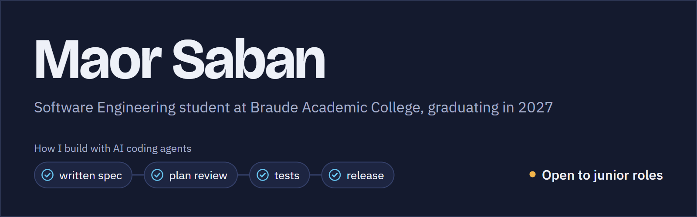
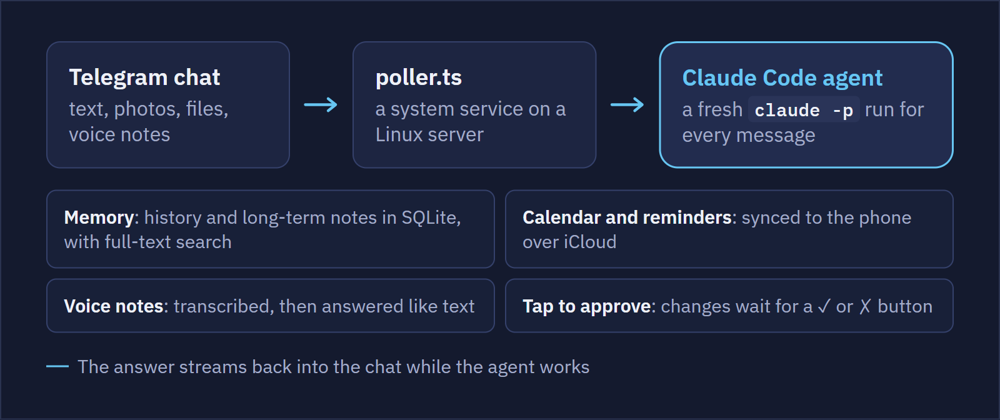
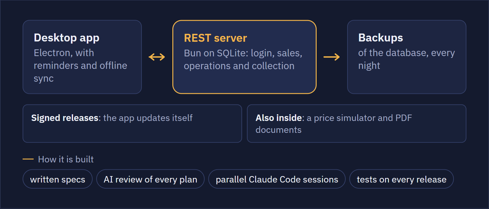
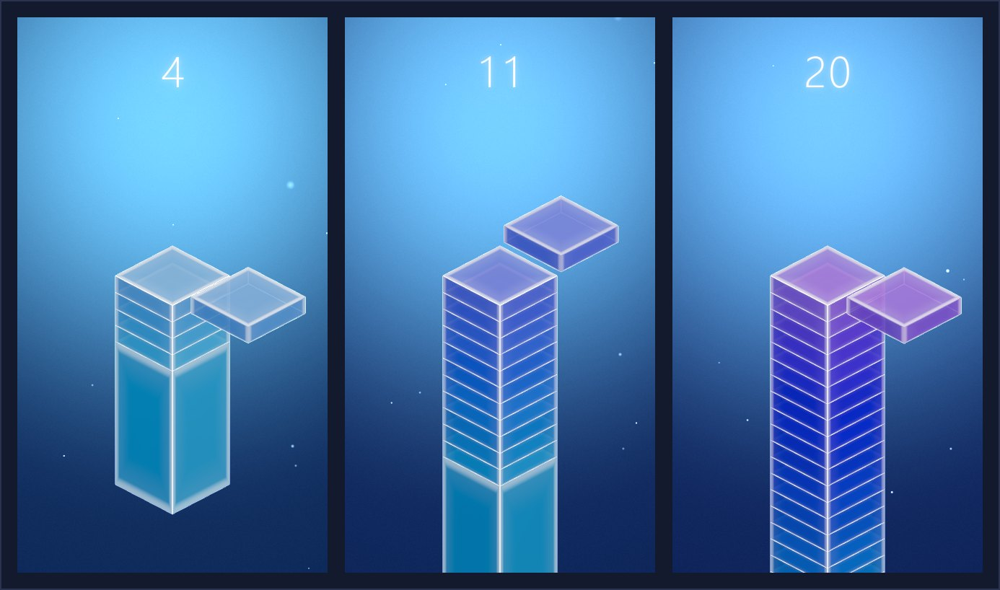
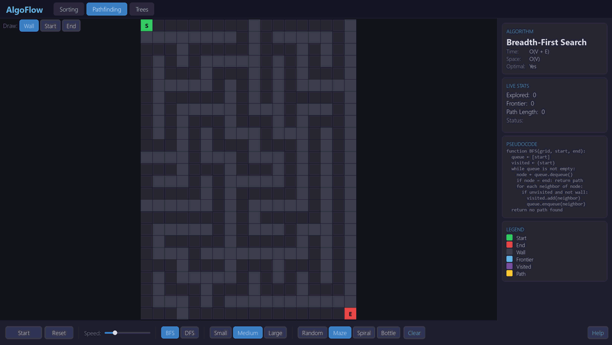
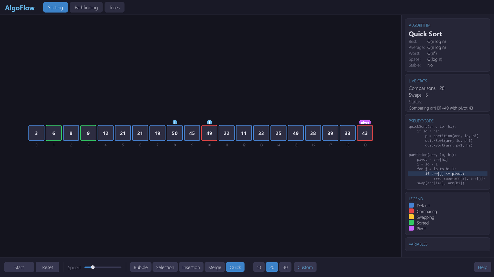
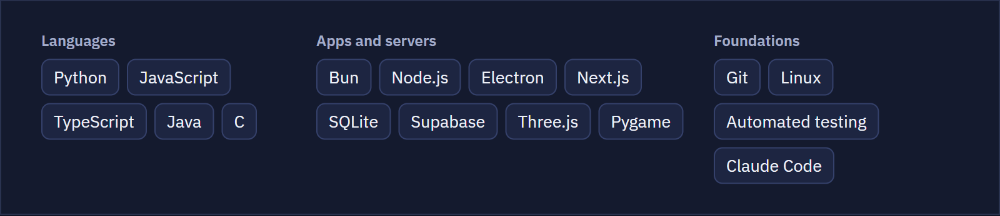

<picture>
  <source media="(max-width: 600px)" srcset="assets/banner-mobile.png">
  
</picture>

## Telegram Agent: a personal AI assistant

A 24/7 assistant on Telegram that runs a Claude Code agent for every message, on a Linux cloud server.

<a href="https://github.com/Maores/claude-telegram-agent">
  <picture>
    <source media="(max-width: 600px)" srcset="assets/telegram-agent-mobile.png">
    
  </picture>
</a>

**TypeScript · Bun · SQLite · Claude Code · DigitalOcean** 
[Source and docs](https://github.com/Maores/claude-telegram-agent)

## DeskFlow: task management for an insurance agency

A desktop system I designed and built end to end for a real client, an insurance agency.

<picture>
  <source media="(max-width: 600px)" srcset="assets/deskflow-mobile.png">
  
</picture>

**Electron · Bun · SQLite** 
A private client project, so the code is not public. [Ask me for a walkthrough](https://www.linkedin.com/in/maor-saban/).

## Stack Tower: a browser game

A block slides across the top of the tower, you tap to drop it, and whatever overhangs is sliced away. Plays on a phone or a desktop, with a shared top-10 leaderboard.

**JavaScript · Three.js · Supabase** 
[Play it](https://maores.github.io/stack-tower/) · [Source](https://github.com/Maores/stack-tower)

## AlgoFlow: algorithms, one step at a time

A desktop visualizer for sorting, pathfinding and tree algorithms, with highlighted pseudocode and live stats at every step.

<a href="https://github.com/Maores/AlgoFlow">
  <picture>
    <source media="(prefers-reduced-motion: reduce)" srcset="assets/algoflow-path-found.png">
    
  </picture>
</a>

See the sorting view

 

**Python · Pygame** 
[Source](https://github.com/Maores/AlgoFlow)

## More things I've built

- **Moodle MCP server**: a local MCP server in Node.js, with no external packages, that lets a Claude agent download new course files from my college Moodle. Read-only, with 29 automated tests. Not public yet.
- **Claude Code skills**: a plan gate where three independent AI reviewers must find flaws before any code is written, and a check that tells when a long AI session should be summarized or restarted. Not public yet.

## Tools I build with

<picture>
  <source media="(max-width: 600px)" srcset="assets/tools-mobile.png">
  
</picture>

Open to junior software engineering roles · [LinkedIn](https://www.linkedin.com/in/maor-saban/)
